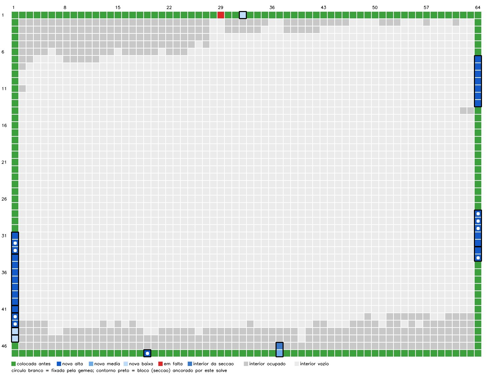

# Borda: colocação das peças de borda das secções por ancorar (`src/border.py`)

Gerado por `python -m src.border --apply --report ...` sobre o projeto `alpes` (projects/alpes; 1904 eventos no log no fim) em 2026-11-01 14:29 (153 s). Etiquetas: **[V]** verificado com evidência, **[NT]** não testado, **[F]** testado e falha.

## Facto de partida

A borda física está completa exceto (1,29) (Tiago, 2026-11-01): cada célula de borda `ocupada_legado` tem uma das peças digitalizadas que o solve do legado deixou por ancorar. O problema é de atribuição (cobertura exata), não de localização livre.

## Inventário

- Peças com ≥ 1 lado F (sem `same_as`/`descartada`): **219** = 185 `colocada` + 34 `em_seccao`; esperado 218 − 1 = 217 (borda completa menos (1,29)) **[V]** (contagem).
- Células de borda livres: 33 = 32 `ocupada_legado` + 1 `vazia` [(1, 29)]; peças candidatas: 37 em 16 blocos (34 com F + P0218 (montado_p01 #25), P0511 (montado_p08 #32), P0657 (montado_p12 #30) sem F: interiores que se movem com a secção, ou peça solta do legado sem 4 cantos).
- 185 colocadas + 34 livres com F = 219 para 217 peças de borda reais: **pelo menos 2 etiquetas F a mais** (lados quase retos ou mordidos; F é evidência fraca; a solução deixa de fora 4 blocos com F e usa as peças sem F acima) **[V]**.

### Calibração na borda colocada

- Gémeas na borda já colocada (pares colocada↔colocada, 83): distância livre mediana 0,309 mm, p90 0,494, 97,6 % ≤ tmax, 1 acima de 1 mm **[V]**: a forma da gémea é evidência forte também nos scans do legado.
- Orientação: os lados F das peças colocadas (pose da secção ancorada ou `theta_deg` da GT) apontam para fora em 185/185 células de borda **[V]** (é o que valida o referencial usado para os vizinhos fixos).
- Custo de lado de vizinhos verdadeiros ao longo da borda (178 pares colocados): mediana 1,37, p90 1,71; 100 % são T↔B (o resto F/T-T/B-B por etiqueta errada) **[V]**; `SIDE_NEUTRAL` = 1,40 ≈ mediana.
- Desvio máximo |y|/corda dos lados F que apontam para fora: p99 0,083, máx 0,111 (n = 189); lados F que NÃO apontam para fora: [] **[V]**; limiar de suspeita `F_SUSPECT_DEV` = 0,120.

### Suspeitas de F

| peça | página | secção | n_F | razão |
|---|---|---|---|---|
| P0292 | montado_p03 #10 | G0022 | 1 | forma danificada (área 480 mm² = 1,45 x célula nominal): lados neutros |
| P0395 | montado_p05 #51 | G0033 | 1 | forma danificada (corda 22,0 mm fora de [14,6, 21,8]): lados neutros; lado 1 F com desvio 0,142 da corda > 0,120 |
| P0651 | montado_p12 #24 | G0064 | 2 | forma danificada (corda 14,5 mm fora de [14,6, 21,8]): lados neutros; dois lados F (canto) mas não há canto livre |
| P0657 | montado_p12 #30 | — | 0 | forma danificada (área 244 mm² = 0,74 x célula nominal): lados neutros; sem 4 cantos: lados neutros |

## Passo 1: gémeas (1 contra 1, só forma)

Para cada célula livre cuja gémea está colocada com silhueta: distância livre à peça colocada de todas as peças livres que passam classe + cordas; pino se d1 ≤ tmax 0,637 e margem ≥ 1,5, ou d1 ≤ t95 0,507 com candidata única. Sem imagem (a arte da borda não discrimina).

| célula | gémea | peça na gémea | passam | top-3 (peça, d mm, passa) | d1 | margem | pino |
|---|---|---|---|---|---|---|---|
| (1,29) | (47,36) | P0512 | 1 | montado_p01 #32 0,980; montado_p12 #17 1,002 ✗; montado_p12 #39 1,063 ✗ | 0,980 | — | — |
| (1,32) | (47,33) | P0496 | 0 | blocos_p02 #18 1,698 ✗; montado_p12 #28 2,268 ✗; montado_p12 #24 2,527 ✗ | — | — | — |
| (28,64) | (20,1) | P0630 | 2 | montado_p01 #5 0,436; montado_p08 #37 1,402 ✗; montado_p01 #35 1,784 | 0,436 | 4,09 | montado_p01 #5 |
| (29,64) | (19,1) | P0661 | 2 | montado_p01 #10 0,438; montado_p12 #17 0,972 ✗; montado_p12 #5 1,015 ✗ | 0,438 | 3,85 | montado_p01 #10 |
| (30,64) | (18,1) | P0662 | 4 | montado_p01 #15 0,269; montado_p12 #38 0,966; montado_p01 #37 1,024 ✗ | 0,269 | 3,59 | montado_p01 #15 |
| (31,1) | (17,64) | P0211 | 1 | montado_p12 #28 0,525; montado_p01 #30 1,317 ✗; montado_p01 #37 2,173 ✗ | 0,525 | — | — |
| (31,64) | (17,1) | P0653 | 4 | montado_p01 #20 0,524 ✗; montado_p12 #6 1,012 ✗; montado_p12 #23 1,127 | 1,127 | 1,04 | — |
| (32,1) | (16,64) | P0206 | 4 | montado_p12 #39 0,349; montado_p12 #17 1,377; montado_p01 #32 1,443 ✗ | 0,349 | 3,94 | montado_p12 #39 |
| (32,64) | (16,1) | P0647 | 0 | montado_p01 #10 1,262 ✗; montado_p12 #17 1,370 ✗; montado_p01 #32 1,524 ✗ | — | — | — |
| (33,1) | (15,64) | P0201 | 2 | montado_p12 #38 0,347; montado_p01 #15 1,025 ✗; montado_p12 #11 1,486 | 0,347 | 4,28 | montado_p12 #38 |
| (33,64) | (15,1) | P0641 | 1 | montado_p01 #30 1,037 ✗; montado_p12 #28 1,151; montado_p08 #32 2,138 ✗ | 1,151 | — | — |
| (34,1) | (14,64) | P0196 | 2 | montado_p12 #5 0,362 ✗; montado_p12 #17 0,985; montado_p01 #10 0,987 ✗ | 0,985 | 1,53 | — |
| (34,64) | (14,1) | P0635 | 2 | montado_p01 #35 0,483; montado_p08 #37 1,343 ✗; montado_p01 #5 1,587 | 0,483 | 3,29 | montado_p01 #35 |
| (42,1) | (6,64) | P0231 | 3 | montado_p12 #12 0,356; montado_p01 #12 0,957 ✗; montado_p12 #41 1,145 ✗ | 0,356 | 4,56 | montado_p12 #12 |
| (43,1) | (5,64) | P0232 | 1 | montado_p12 #18 0,495; montado_p01 #22 1,319 ✗; montado_p12 #29 1,365 ✗ | 0,495 | — | montado_p12 #18 |
| (44,1) | (4,64) | P0233 | 1 | montado_p01 #5 0,871 ✗; montado_p08 #37 1,210; montado_p01 #35 1,536 ✗ | 1,210 | — | — |
| (45,1) | (3,64) | P0234 | 0 | montado_p12 #17 0,932 ✗; montado_p01 #10 0,933 ✗; montado_p01 #32 0,987 ✗ | — | — | — |
| (47,19) | (1,46) | P0280 | 6 | montado_p10 #39 0,477; montado_p12 #23 0,773; montado_p01 #27 0,843 | 0,477 | 1,62 | montado_p10 #39 |
| (47,37) | (1,28) | P0301 | 1 | montado_p08 #37 0,572; montado_p01 #5 1,180 ✗; montado_p01 #35 1,595 ✗ | 0,572 | — | — |

9 pinos (restrição dura na cadeia). Verificação: cada pino retirado à vez, a cadeia sozinha (lados + restantes pinos + ΔE) põe a peça na mesma célula?
- P0198 (montado_p01 #5) → (28,64): sem o pino vai para (28, 64) — **concorda** [V]
- P0203 (montado_p01 #10) → (29,64): sem o pino vai para (29, 64) — **concorda** [V]
- P0208 (montado_p01 #15) → (30,64): sem o pino vai para (30, 64) — **concorda** [V]
- P0228 (montado_p01 #35) → (34,64): sem o pino vai para (34, 64) — **concorda** [V]
- P0589 (montado_p10 #39) → (47,19): sem o pino vai para (47, 19) — **concorda** [V]
- P0639 (montado_p12 #12) → (42,1): sem o pino vai para (42, 1) — **concorda** [V]
- P0645 (montado_p12 #18) → (43,1): sem o pino vai para (43, 1) — **concorda** [V]
- P0665 (montado_p12 #38) → (33,1): sem o pino vai para (33, 1) — **concorda** [V]
- P0666 (montado_p12 #39) → (32,1): sem o pino vai para (32, 1) — **concorda** [V]

## Passo 2: cadeia (cobertura exata com custo)

Colunas das tabelas, por peça: custo `F fora`, `lados fixos` (contra peças já ancoradas), `lados internos` (dentro da secção), ΔE da peça na célula; os lados entre blocos novos entram no custo do segmento.

Custo = lados frente a frente (T↔B: RMS + 0,5·Δcorda, teto 4,0; F frente a peça 2,5; T-T/B-B 4,0; lado desconhecido 1,40) + 3,0 por direção de borda sem F + 4,0·d(gémea) (teto 1,5 mm) + 0,03·ΔE. Custo total ótimo 142,51. Margem de um bloco = (C₂ − C₁ + c_B)/c_B, C₂ = melhor solução com uma peça do bloco fora da sua célula, c_B = termos de custo que envolvem o bloco; margem de um segmento idem com outra atribuição no segmento. `alta` = fixada pela gémea ou margem ≥ margin_min; `media` ≥ 1,2; `baixa` abaixo.

### coluna 1, filas 31–45 (15 células)

Blocos: G0059 rot 0° em (31, 1); G0055 rot 0° em (34, 1); G0063 rot 0° em (41, 1); G0060 rot 0° em (42, 1); P0657 rot 270° em (44, 1); G0064 rot 0° em (45, 1). Custo do segmento 69,02, 2.ª melhor solução 142,75 vs 142,51 → margem **1,00**.

| célula | peça | página | bloco | rot | conf. | margem do bloco | gémea d mm | F fora | lados fixos | lados internos | ΔE | alternativa |
|---|---|---|---|---|---|---|---|---|---|---|---|---|
| (31,1) | P0655 | montado_p12 #28 | G0059 | 0 | alta | pino | 0,525 | 0,0 | 2,25 | 1,30 | 31,9 | — |
| (32,1) | P0666 📌 | montado_p12 #39 | G0059 | 0 | alta | pino | 0,349 | 0,0 | 0,00 | 1,03 | 22,6 | — |
| (33,1) | P0665 📌 | montado_p12 #38 | G0059 | 0 | alta | pino | 0,347 | 0,0 | 0,00 | 0,00 | 11,0 | — |
| (34,1) | P0632 | montado_p12 #5 | G0055 | 0 | alta | ≥ 1,50 | 0,362 | 0,0 | 0,00 | 1,30 | 15,2 | — |
| (35,1) | P0638 | montado_p12 #11 | G0055 | 0 | alta | ≥ 1,50 | — | 0,0 | 0,00 | 1,69 | 26,7 | — |
| (36,1) | P0644 | montado_p12 #17 | G0055 | 0 | alta | ≥ 1,50 | — | 0,0 | 0,00 | 1,58 | 25,6 | — |
| (37,1) | P0650 | montado_p12 #23 | G0055 | 0 | alta | ≥ 1,50 | — | 0,0 | 0,00 | 1,12 | 11,5 | — |
| (38,1) | P0656 | montado_p12 #29 | G0055 | 0 | alta | ≥ 1,50 | — | 0,0 | 0,00 | 1,51 | 19,6 | — |
| (39,1) | P0667 | montado_p12 #40 | G0055 | 0 | alta | ≥ 1,50 | — | 0,0 | 0,00 | 1,65 | 17,6 | — |
| (40,1) | P0668 | montado_p12 #41 | G0055 | 0 | alta | ≥ 1,50 | — | 0,0 | 0,00 | 0,00 | 14,1 | — |
| (41,1) | P0633 | montado_p12 #6 | G0063 | 0 | alta | ≥ 1,50 | — | 0,0 | 0,00 | 0,00 | 19,2 | — |
| (42,1) | P0639 📌 | montado_p12 #12 | G0060 | 0 | alta | pino | 0,356 | 0,0 | 0,00 | 1,86 | 29,8 | — |
| (43,1) | P0645 📌 | montado_p12 #18 | G0060 | 0 | alta | pino | 0,495 | 0,0 | 1,26 | 0,00 | 16,1 | — |
| (44,1) | P0657 | montado_p12 #30 | P0657 | 270 | baixa | 1,02 | 1,500 | 0,0 | 1,40 | 0,00 | 29,3 | montado_p05 #51 |
| (45,1) | P0651 | montado_p12 #24 | G0064 | 0 | baixa | 1,04 | 1,500 | 0,0 | 2,80 | 0,00 | 11,9 | montado_p05 #51 |

### (47,19) (1 células)

Blocos: G0050 rot 0° em (47, 19). Custo do segmento 7,41, 2.ª melhor solução 146,22 vs 142,51 → margem **≥ 1,50**.

| célula | peça | página | bloco | rot | conf. | margem do bloco | gémea d mm | F fora | lados fixos | lados internos | ΔE | alternativa |
|---|---|---|---|---|---|---|---|---|---|---|---|---|
| (47,19) | P0589 📌 | montado_p10 #39 | G0050 | 0 | alta | pino | 0,477 | 0,0 | 4,71 | 0,00 | 26,5 | — |

### (1,32) (1 células)

Blocos: G0022 rot 180° em (1, 32). Custo do segmento 8,98, 2.ª melhor solução 144,15 vs 142,51 → margem **1,18**.

| célula | peça | página | bloco | rot | conf. | margem do bloco | gémea d mm | F fora | lados fixos | lados internos | ΔE | alternativa |
|---|---|---|---|---|---|---|---|---|---|---|---|---|
| (1,32) | P0292 | montado_p03 #10 | G0022 | 180 | baixa | 1,18 | 1,500 | 0,0 | 2,80 | 0,00 | 5,9 | montado_p05 #51 |

### (47,37) (1 células)

Blocos: G0045 rot 0° em (46, 37). Custo do segmento 6,80, 2.ª melhor solução 145,22 vs 142,51 → margem **1,40**.

| célula | peça | página | bloco | rot | conf. | margem do bloco | gémea d mm | F fora | lados fixos | lados internos | ΔE | alternativa |
|---|---|---|---|---|---|---|---|---|---|---|---|---|
| (47,37) | P0516 | montado_p08 #37 | G0045 | 0 | media | 1,40 | 0,572 | 0,0 | 2,81 | 0,00 | 24,3 | montado_p05 #51 |

### coluna 64, filas 7–13 (7 células)

Blocos: G0003 rot 0° em (7, 64). Custo do segmento 21,45, 2.ª melhor solução 153,24 vs 142,51 → margem **≥ 1,50**.

| célula | peça | página | bloco | rot | conf. | margem do bloco | gémea d mm | F fora | lados fixos | lados internos | ΔE | alternativa |
|---|---|---|---|---|---|---|---|---|---|---|---|---|
| (7,64) | P0200 | montado_p01 #7 | G0003 | 0 | alta | ≥ 1,50 | — | 0,0 | 1,05 | 1,12 | 14,2 | — |
| (8,64) | P0205 | montado_p01 #12 | G0003 | 0 | alta | ≥ 1,50 | — | 0,0 | 0,00 | 1,27 | 14,0 | — |
| (9,64) | P0210 | montado_p01 #17 | G0003 | 0 | alta | ≥ 1,50 | — | 0,0 | 0,00 | 0,83 | 11,7 | — |
| (10,64) | P0215 | montado_p01 #22 | G0003 | 0 | alta | ≥ 1,50 | — | 0,0 | 0,00 | 1,07 | 12,3 | — |
| (11,64) | P0220 | montado_p01 #27 | G0003 | 0 | alta | ≥ 1,50 | — | 0,0 | 0,00 | 0,91 | 13,5 | — |
| (12,64) | P0225 | montado_p01 #32 | G0003 | 0 | alta | ≥ 1,50 | — | 0,0 | 0,00 | 0,83 | 14,2 | — |
| (13,64) | P0230 | montado_p01 #37 | G0003 | 0 | alta | ≥ 1,50 | — | 0,0 | 1,21 | 0,00 | 13,5 | — |

### coluna 64, filas 28–34 (7 células)

Blocos: G0005 rot 0° em (28, 64); G0008 rot 0° em (33, 64). Custo do segmento 39,22, 2.ª melhor solução 146,81 vs 142,51 → margem **1,11**.

| célula | peça | página | bloco | rot | conf. | margem do bloco | gémea d mm | F fora | lados fixos | lados internos | ΔE | alternativa |
|---|---|---|---|---|---|---|---|---|---|---|---|---|
| (28,64) | P0198 📌 | montado_p01 #5 | G0005 | 0 | alta | pino | 0,436 | 0,0 | 1,27 | 1,35 | 31,9 | — |
| (29,64) | P0203 📌 | montado_p01 #10 | G0005 | 0 | alta | pino | 0,438 | 0,0 | 0,00 | 1,29 | 7,0 | — |
| (30,64) | P0208 📌 | montado_p01 #15 | G0005 | 0 | alta | pino | 0,269 | 0,0 | 0,00 | 1,86 | 8,8 | — |
| (31,64) | P0213 | montado_p01 #20 | G0005 | 0 | alta | pino | 0,524 | 0,0 | 0,00 | 1,30 | 13,2 | — |
| (32,64) | P0218 | montado_p01 #25 | G0005 | 0 | alta | pino | 2,749 | 3,0 | 0,00 | 0,00 | 26,7 | — |
| (33,64) | P0223 | montado_p01 #30 | G0008 | 0 | alta | pino | 1,037 | 0,0 | 0,00 | 0,98 | 16,5 | — |
| (34,64) | P0228 📌 | montado_p01 #35 | G0008 | 0 | alta | pino | 0,483 | 0,0 | 3,00 | 0,00 | 16,0 | — |

Células interiores ocupadas pelas secções (peças sem F que se movem com o bloco): (46,37) P0511 (montado_p08 #32).

## Resumo das decisões

- Células decididas: 32 de 32 a cobrir; por gémea 9, pelo bloco de uma peça fixada pela gémea 4, pela cadeia/eliminação 19.
- Confiança: alta 28, media 1, baixa 3.
- (1,29): fica vazia (não há exatamente uma sobra).
- Peças/blocos que sobram (não colocados): peça interior com um lado quase reto etiquetado F, peça danificada, ou a peça é a de outra célula e a escolhida está errada. Para cada peça, a forma colocada mais próxima (se for a gémea, a peça pertence à célula gémea dessa):
  - G0033: P0395 (montado_p05 #51): mais próxima P0459 em (46,42) a 3,503 mm → célula gémea (2,23) `colocada` [forma danificada (corda 22,0 mm fora de [14,6, 21,8]): lados neutros; lado 1 F com desvio 0,142 da corda > 0,120]
  - G0069: P0777 (montado_p15 #3): mais próxima P0289 em (1,33) a 1,398 mm → célula gémea (47,32) `colocada`
  - G0082: P0844 (blocos_p01 #11): mais próxima P0348 em (45,64) a 1,330 mm → célula gémea (3,1) `colocada`
  - G0093: P0879 (blocos_p02 #18): mais próxima P0634 em (7,1) a 0,955 mm → célula gémea (41,64) `colocada`

## Verificar fisicamente

Última coluna: as 3 formas mais próximas da peça colocada na célula gémea entre **todas** as peças do projeto (não só as candidatas): se nenhuma está perto (≤ tmax), a peça desta célula não tem gémea digitalizada com forma fiável, ou a peça colocada na célula gémea está ela própria errada/danificada.

| célula | peça proposta | página | conf. | margem | porquê | alternativa (2.ª melhor) | gémea no projeto (top-3) |
|---|---|---|---|---|---|---|---|
| (1,32) | P0292 | montado_p03 #10 | baixa | 1,18 | P0292 em (1,32): forma danificada, a gémea colocada não testa | P0395 (montado_p05 #51) | P0643 1,35 mm (colocada (29, 1)); P0613 1,48 mm (colocada (47, 7)); P0265 1,49 mm (colocada (1, 58)) |
| (32,64) | P0218 | montado_p01 #25 | alta | pino | P0218 em (32,64): gémea colocada a 2,75 mm > 1,0 (bloco fixado por pino) | — | P0039 0,84 mm (colocada (47, 44)); P0264 0,86 mm (colocada (1, 49)); P0029 0,88 mm (colocada (47, 54)) |
| (33,64) | P0223 | montado_p01 #30 | alta | pino | P0223 em (33,64): gémea colocada a 1,04 mm > 1,0 (bloco fixado por pino) | — | P0025 0,79 mm (colocada (47, 60)); P0001 0,87 mm (colocada (1, 5)); P0283 0,92 mm (colocada (1, 36)) |
| (44,1) | P0657 | montado_p12 #30 | baixa | 1,02 | P0657 em (44,1): forma danificada, a gémea colocada não testa | P0395 (montado_p05 #51) | P0492 0,87 mm (colocada (47, 32)); P0198 0,87 mm (em_seccao); P0214 0,88 mm (colocada (38, 64)) |
| (45,1) | P0651 | montado_p12 #24 | baixa | 1,04 | P0651 em (45,1): forma danificada, a gémea colocada não testa | P0395 (montado_p05 #51) | P0672 0,73 mm (colocada (2, 1)); P0349 0,76 mm (colocada (46, 64)); P0661 0,91 mm (colocada (19, 1)) |
| (47,37) | P0516 | montado_p08 #37 | media | 1,40 | margem | P0395 (montado_p05 #51) | P0516 0,57 mm (em_seccao); P0492 0,83 mm (colocada (47, 32)); P0214 1,09 mm (colocada (38, 64)) |

Pares de gémeas já colocados (fora deste solve) com distância > 1 mm, a rever: (1,33) P0289 ↔ (47,32) P0492 a 2,83 mm **[V]**.

## Aplicação

12 operações no log (`section_anchored` / `placed`, fonte `legado_scan`, origem `borda`). Depois: `missing_border_cells()` = [(1, 29)]; borda `ocupada_legado` = 0; `check_invariants()` = OK **[V]**.

## Figura

 — `borda_tabuleiro.jpg`: anel da borda; verde = colocada antes, azul = colocada por este solve (escuro alta, médio media, claro baixa; círculo branco = fixada pela gémea; contorno preto = bloco), vermelho = em falta, cinzento = interior.

## O que não está verificado

- Nenhuma das colocações novas foi confirmada fisicamente **[NT]**: a lista acima é a ordem de verificação.
- A margem por custo depende de pesos escolhidos (não calibrados contra GT de borda colocada por este solve) **[NT]**.
